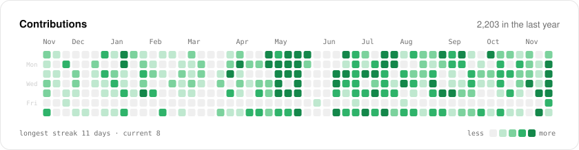
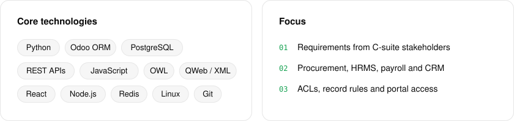
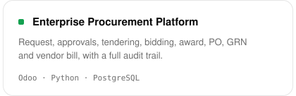
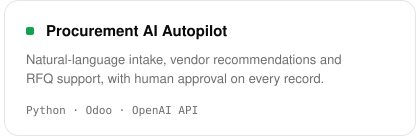
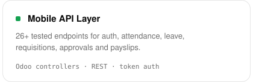
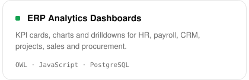
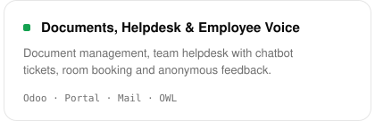
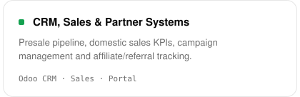

<!-- Cards are drawn by scripts/build_cards.py from profile.json and live GitHub data, published to the `output` branch daily. -->

<picture><source media="(prefers-color-scheme: dark)" srcset="https://raw.githubusercontent.com/Mushfikur007/Mushfikur007/output/header-dark.svg"></picture>

<picture><source media="(prefers-color-scheme: dark)" srcset="https://raw.githubusercontent.com/Mushfikur007/Mushfikur007/output/stats-dark.svg"></picture>

<picture><source media="(prefers-color-scheme: dark)" srcset="https://raw.githubusercontent.com/Mushfikur007/Mushfikur007/output/calendar-dark.svg"></picture>

<picture><source media="(prefers-color-scheme: dark)" srcset="https://raw.githubusercontent.com/Mushfikur007/Mushfikur007/output/stack-dark.svg"></picture>

<picture><source media="(prefers-color-scheme: dark)" srcset="https://raw.githubusercontent.com/Mushfikur007/Mushfikur007/output/work-1-dark.svg"></picture>
<picture><source media="(prefers-color-scheme: dark)" srcset="https://raw.githubusercontent.com/Mushfikur007/Mushfikur007/output/work-2-dark.svg"></picture>
<picture><source media="(prefers-color-scheme: dark)" srcset="https://raw.githubusercontent.com/Mushfikur007/Mushfikur007/output/work-3-dark.svg"></picture>
<picture><source media="(prefers-color-scheme: dark)" srcset="https://raw.githubusercontent.com/Mushfikur007/Mushfikur007/output/work-4-dark.svg"></picture>
<picture><source media="(prefers-color-scheme: dark)" srcset="https://raw.githubusercontent.com/Mushfikur007/Mushfikur007/output/work-5-dark.svg"></picture>
<picture><source media="(prefers-color-scheme: dark)" srcset="https://raw.githubusercontent.com/Mushfikur007/Mushfikur007/output/work-6-dark.svg"></picture>

<picture><source media="(prefers-color-scheme: dark)" srcset="https://raw.githubusercontent.com/Mushfikur007/Mushfikur007/output/about-dark.svg"></picture>

<a href="https://mushfikur-rahman-portfolio.vercel.app/">portfolio</a> &nbsp;·&nbsp; 
<a href="https://www.linkedin.com/in/mushfikur-rahman-537735203">linkedin</a> &nbsp;·&nbsp; 
<a href="mailto:mail.mushfikurrahman@gmail.com">email</a>

