  

  
  
  
  

  

  

<h3 align="center">⚙️ the toolbox</h3>

  

<h3 align="center">🐍 eating my contribution graph</h3>

  <picture>
    <source media="(prefers-color-scheme: dark)" srcset="https://raw.githubusercontent.com/Mushfikur007/Mushfikur007/output/snake-dark.svg"/>
    <source media="(prefers-color-scheme: light)" srcset="https://raw.githubusercontent.com/Mushfikur007/Mushfikur007/output/snake-light.svg"/>
    
  </picture>

Built in Dhaka · balancing ledgers and shipping Odoo modules since 2022

