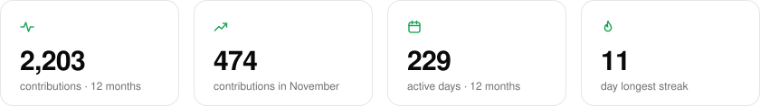

<!-- Cards are drawn by scripts/build_cards.py from live GitHub data and published to the `output` branch daily. -->

<picture><source media="(prefers-color-scheme: dark)" srcset="https://raw.githubusercontent.com/Mushfikur007/Mushfikur007/output/header-dark.svg"></picture>

<picture><source media="(prefers-color-scheme: dark)" srcset="https://raw.githubusercontent.com/Mushfikur007/Mushfikur007/output/stats-dark.svg"></picture>

<picture><source media="(prefers-color-scheme: dark)" srcset="https://raw.githubusercontent.com/Mushfikur007/Mushfikur007/output/calendar-dark.svg"></picture>

<picture><source media="(prefers-color-scheme: dark)" srcset="https://raw.githubusercontent.com/Mushfikur007/Mushfikur007/output/stack-dark.svg"></picture>

<a href="https://github.com/Mushfikur007/ora"><picture><source media="(prefers-color-scheme: dark)" srcset="https://raw.githubusercontent.com/Mushfikur007/Mushfikur007/output/project-ora-dark.svg"></picture></a>
<a href="https://github.com/Mushfikur007/EduHub"><picture><source media="(prefers-color-scheme: dark)" srcset="https://raw.githubusercontent.com/Mushfikur007/Mushfikur007/output/project-eduhub-dark.svg"></picture></a>
<a href="https://github.com/Mushfikur007/EasyEV-Charging-using-php-and-mySQL"><picture><source media="(prefers-color-scheme: dark)" srcset="https://raw.githubusercontent.com/Mushfikur007/Mushfikur007/output/project-easyev-charging-using-php-and-mysql-dark.svg"></picture></a>
<a href="https://github.com/Mushfikur007/portfolio"><picture><source media="(prefers-color-scheme: dark)" srcset="https://raw.githubusercontent.com/Mushfikur007/Mushfikur007/output/project-portfolio-dark.svg"></picture></a>

<a href="https://mushfikur007.github.io/portfolio/">portfolio</a> &nbsp;·&nbsp; 
<a href="https://www.linkedin.com/in/mushfikur-rahman-537735203">linkedin</a> &nbsp;·&nbsp; 
<a href="mailto:mushfikurrahman1624@gmail.com">email</a>

